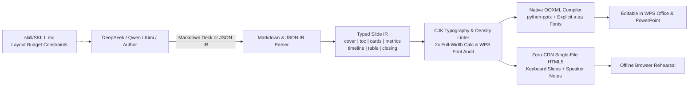

English | [简体中文](./README_zh.md)

# cnppt-kit

**China-ready Markdown/JSON to native WPS & PowerPoint (`.pptx`) compiler, CJK typography linter, Agent Skill, and 2026 open-source PPT ecosystem guide.**

[](./LICENSE)
[](./pyproject.toml)
[](./src/cnppt_kit/pptx_builder.py)

`cnppt-kit` distills the engineering lessons from top-starred GitHub presentation ecosystems into a workflow tailored for Chinese academic defenses, university innovation roadshows, and enterprise/SOE reporting: **editable OOXML shapes (not flat screenshots)**, **explicit EastAsian (`<a:ea>`) font XML binding for WPS & MS PowerPoint**, **CJK full-width overflow linting**, and **zero-CDN offline previews**.

For the full Chinese landscape benchmark covering 15 high-star GitHub PPT repositories and MIT/Apache vs AGPL-3.0 commercial compliance pitfalls, see [ECOSYSTEM_SURVEY_ZH.md](./docs/ECOSYSTEM_SURVEY_ZH.md).

---

## Architecture



---

## Six Design Principles Distilled from Top-Starred Repos

| Principle | Learned From | Implemented in `cnppt-kit` |
| --- | --- | --- |
| **Structured Slide IR** | `PPTist` schema & `Kami` constraints | Separates semantic layout (`cards`, `metrics`, `timeline`, `table`) from pixel coordinates |
| **Native Editable OOXML** | `ppt-master` & `python-pptx` | Generates editable rounded cards, KPI boxes, native tables, and speaker notes instead of static page images |
| **EastAsian Font Safety** | WPS / cross-OS Chinese typesetting | Injects both `<a:latin>` and `<a:ea>` XML nodes (`Microsoft YaHei` / `Source Han Sans SC` / `PingFang SC`) |
| **CJK Density Linting** | `huashu-design` style audit | Computes Unicode `east_asian_width` (2x for CJK glyphs) to catch multi-line title wrapping and dense Word-wall slides |
| **Domestic Scenario Scaffolds** | Thesis defense, pitch contests, SOE reviews | Ships ready-to-compile templates (`defense`, `pitch`, `report`) and 4 high-contrast palettes |
| **License & Intranet Readiness** | MIT/Apache vs AGPL-3.0 ecosystem audit | Clean **MIT** codebase with zero runtime CDN calls—ready for university labs, offline laptops, and DeepSeek/Ollama workflows |

---

## 30-Second QuickStart

```bash
git clone https://github.com/forgemorrow/cnppt-kit.git
cd cnppt-kit
pip install -e ".[dev]"

# 1. Inspect available domestic themes and templates
cnppt templates

# 2. Scaffold a thesis defense, roadshow pitch, or executive report outline
cnppt scaffold defense -o my_defense.md

# 3. Audit CJK line-overflow, slide density, and WPS font safety
cnppt lint examples/defense_outline.md --strict

# 4. Compile native editable .pptx + zero-CDN offline HTML preview
cnppt build examples/defense_outline.md -o defense.pptx --html defense.html
```

To attach as a reusable **Agent Skill** in DeepSeek Harness, Cursor, Claude Code, or Antigravity, load [`skill/SKILL.md`](./skill/SKILL.md).

---

## Measured Verification & Benchmark Output

Running `pytest -v` and `python scripts/benchmark_linter.py`:

* **Test Suite (`pytest`)**: `11 passed in 0.77s` — validates Markdown/JSON IR parsing, CJK width metrics, linter rules, offline HTML preview (`0` external `http://`/`https://` assets), Windows `cp1252` console UTF-8 reconfiguration, CLI exit codes, and reloaded `.pptx` inspection verifying native tables, speaker notes, and `<a:ea typeface="Microsoft YaHei"/>` XML elements.
* **CJK Linter & Compiler Benchmark** (12 labeled test decks across 6 defective layouts + 6 well-proportioned Chinese decks):

```text
[cnppt-kit benchmark] cases=12 TP=6 TN=6 FP=0 FN=0 Precision=100.0% Recall=100.0% F1=100.0% FPR=0.0%
  Avg PPTX OOXML compile latency (3 domestic demo decks): 26.19ms
```

---

## CLI Reference

* `cnppt templates` — List built-in themes (`academic`, `pitch`, `executive`, `minimal`) and domestic outline scaffolds (`defense`, `pitch`, `report`).
* `cnppt scaffold <defense|pitch|report> -o outline.md` — Generate a ready-to-edit Chinese Markdown presentation outline.
* `cnppt lint <input.md|json> [--json] [--strict]` — Check CJK title length (`<= 22` warning, `> 30` error), body density (`<= 220` eq. chars), card/table bounds, safe font table, and optional speaker notes.
* `cnppt build <input.md|json> -o out.pptx [--theme ...] [--html preview.html] [--strict]` — Compile native OOXML `.pptx` and optional offline HTML5 speaker-notes deck.

## License

Released under the [MIT License](./LICENSE). All templates, themes, and compiler modules are original work; external high-star projects referenced in the survey are cited by repository URL and license without copying third-party code.
