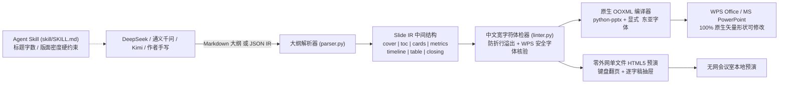

[English](./README.md) | 简体中文

# cnppt-kit

**吸收 GitHub 高星开源 PPT 架构精华、专门面向国内办公与汇报场景打造的 Markdown/JSON → WPS 与 PowerPoint 原生可编辑 `.pptx` 编译器、中文排版体检器与 Agent Skill（含 2026 高星开源 PPT 生态深度调研与协议避坑指南）。**

[](./LICENSE)
[](./pyproject.toml)
[](./src/cnppt_kit/pptx_builder.py)

海外高星工具（`reveal.js`、`Slidev`、`Presenton` 等）大多偏重纯英文网页展示、外部字体 CDN 或多模态云端生图，放到国内**学位答辩、高校双创路演、国企/职场述职**中常遇到三大尴尬：**无法在 WPS 中逐字编辑、中英混排字宽估算失准导致文字溢出、以及部分 AGPL-3.0 协议与海外依赖难以在内网合规落地**。

`cnppt-kit` 将 **高星开源项目选型指南** 与 **本土原生编排引擎** 合二为一：大模型只需专注编写结构化 Markdown/JSON 大纲，确定性引擎负责核算汉字宽度、注入东亚字体 XML、并导出真原生可编辑 `.pptx` 与零外网离线 HTML 预演文件。

---

## 一、高星开源 PPT 生态全景与国内选型速览

> 完整 15 个高星项目（含 `ppt-master` 76.7k★、`reveal.js` 72.6k★、`slidev` 49.5k★、`OfficeCLI` 33.3k★、`guizang-ppt-skill` 29.8k★、`huashu-design` 29.5k★、`banana-slides` 16.0k★、`marp` 12.7k★、`Kami` 12.5k★、`presenton` 11.9k★、`PPTist` 9.5k★ 等）逐项架构对比、WPS 适配评分与商用协议分析见 [**docs/ECOSYSTEM_SURVEY_ZH.md**](./docs/ECOSYSTEM_SURVEY_ZH.md)。

| 国内使用场景 | 推荐开源参照 | 选型要点与避坑提示 |
| --- | --- | --- |
| **需要进 WPS/PPT 逐字改稿** | `hugohe3/ppt-master` (MIT)、`iOfficeAI/OfficeCLI` (Apache-2.0)、**`cnppt-kit` (MIT)** | 优先输出原生 OOXML 矢量形状与表格，避免“网页截图贴图”导出后改不了数字 |
| **高审美中文设计规范 + Agent** | `alchaincyf/huashu-design` (MIT)、`tw93/Kami` (MIT) | 借鉴“版式约束 + 外观体检”；注意 `op7418/guizang-ppt-skill` 与 `banana-slides` 为 **AGPL-3.0** |
| **团队协作/在线类 PPT 编辑器** | `pipipi-pikachu/PPTist` (**AGPL-3.0**)、`presenton/presenton` (Apache-2.0) | 对外提供 SaaS 服务前务必核查 AGPL-3.0 传染性源码公开要求 |
| **纯程序员 Markdown 技术分享** | `slidevjs/slidev` (MIT)、`marp-team/marp` (MIT)、`hakimel/reveal.js` (MIT) | 适合浏览器/代码演示；汇报答辩若需提交 `.pptx` 请做好双端字体核验 |

---

## 二、整体架构与核心能力



从高星项目学到的 **6 项国内落地核心特性**：
1. **结构化 Slide IR 解耦**：分离“语义版式”与“像素坐标”，防止大模型直出坐标造成文字重叠。
2. **东亚字体 `<a:ea>` XML 原生注入**：同时写入 `<a:latin>` 与 `<a:ea>`（微软雅黑 / 思源黑体 / 苹方等预装安全字体），彻底解决跨电脑打开回退成默认宋体的问题。
3. **中英混排防溢出体检（`cnppt lint`）**：通过 Unicode `east_asian_width` 按 `2:1` 权重计算等效汉字长度，编译前拦截超 22/30 字折行主标题、Word 式文字墙、超 4 张拥挤卡片及宽表格。
4. **国内三大高复用母版与示例**：原生附带**学术答辩（`defense`）**、**双创大赛路演（`pitch`）**、**职场/国企述职（`report`）**全套中文示范脚本与 4 套高对比主题。
5. **零 CDN 离线 HTML 预演**：一条命令导出纯内联 HTML5 幻灯片与演讲备注抽屉，断网投影也能键盘直接翻页演示。
6. **即插即用 Agent Skill（[`skill/SKILL.md`](./skill/SKILL.md)）**：适配 DeepSeek Harness、Cursor、Claude Code 与 Antigravity，让国产/本地模型稳定生成一次过检的汇报大纲。

---

## 三、30 秒快速上手

```bash
git clone https://github.com/forgemorrow/cnppt-kit.git
cd cnppt-kit
pip install -e ".[dev]"

# 1. 查看内置中文主题与三大场景脚手架
cnppt templates

# 2. 一键生成学位答辩 / 双创路演 / 职场述职示范大纲
cnppt scaffold defense -o my_defense.md

# 3. 排版密度、中文溢出与 WPS 字体体检
cnppt lint examples/defense_outline.md --strict

# 4. 生成可在 WPS/PowerPoint 中逐字修改的 .pptx 与离线 HTML 预演
cnppt build examples/defense_outline.md -o defense.pptx --html defense.html
```

---

## 四、实测验证与性能数据

在最后一次提交代码后实测运行结果：

* **自动化测试（`pytest -v`）**：**`11 passed in 0.77s`** — 覆盖 Markdown/JSON 解析、汉字视觉宽度算法、CJK 溢出体检、离线 HTML 无外链校验（`0` 外部 `http/https` 依赖）、Windows `cp1252` 控制台 UTF-8 编码自动兼容、CLI 退出码，以及使用 `python-pptx` 重新打开生成的 `.pptx` 检查原生表格、演讲备注与 `<a:ea typeface="Microsoft YaHei"/>` XML 节点。
* **CJK 排版体检与编译耗时基准评测（`python scripts/benchmark_linter.py`）**：在 12 组正负标签演示文稿样本（6 类典型过长标题/文字墙/过多卡片/宽表/非安全字体缺陷 vs 6 组含三大国内示例的规范文稿）上实测：

```text
[cnppt-kit benchmark] cases=12 TP=6 TN=6 FP=0 FN=0 Precision=100.0% Recall=100.0% F1=100.0% FPR=0.0%
  Avg PPTX OOXML compile latency (3 domestic demo decks): 26.19ms
```

* 三大国内场景示范文件（[examples/defense_outline.md](./examples/defense_outline.md)、[examples/pitch_outline.md](./examples/pitch_outline.md)、[examples/report_outline.md](./examples/report_outline.md)）严格体检均得分 **`100/100 PASS`**。

---

## 开源协议

基于 [MIT License](./LICENSE) 开源。全部代码、主题与模板均为原创编写；生态对比调研中提及的第三方高星开源项目均仅提供规范仓库链接与协议提示，不包含任何第三方复制源码。
